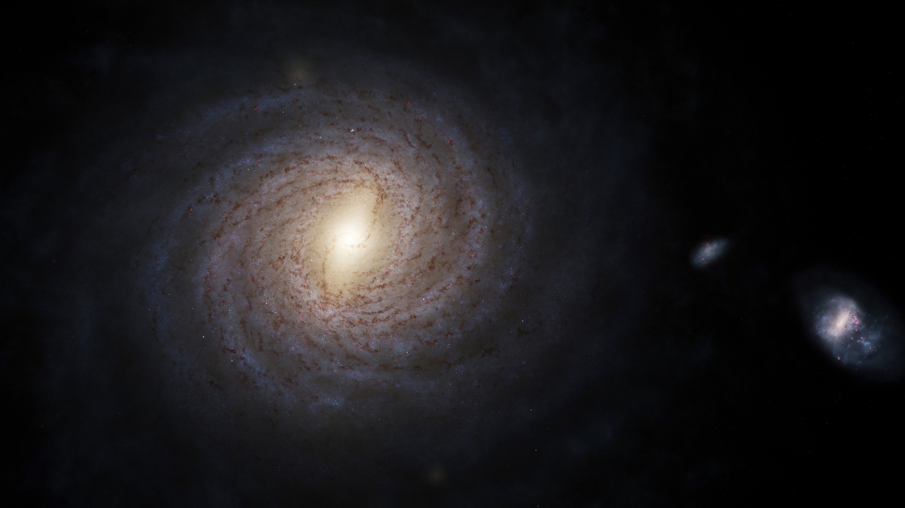
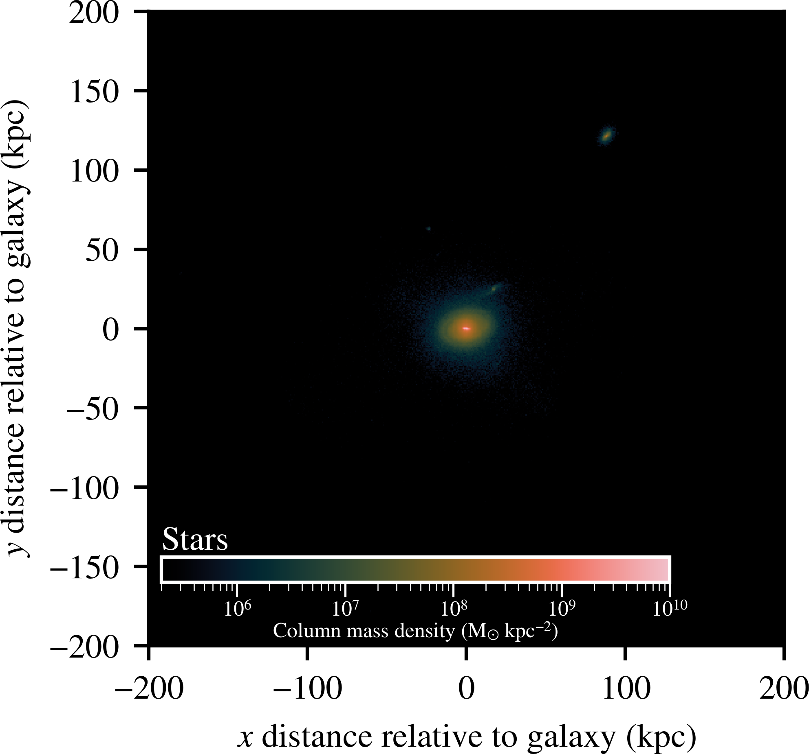

<h3 style='margin-top:0.25rem'><i class="fa-duotone fa-solid fa-triangle-exclamation"></i> Warning!</h3> This page is still under construction. Feel free to read what's here now, but check back soon to see it all polished up.

The fundamental aim of my research is to better understand the Universe around us. In particular, we think that everything we can see, all the "normal stuff," (what astrophysicists call "baryonic matter") is only a small fraction of what's actually present around us. The rest of the matter in the Universe is given the label "dark matter." I study dark matter in and around the Milky Way galaxy&mdash;where we live&mdash;and the satellite galaxies that are in orbit around the Milky Way. Keep reading for some background about our Galaxy and dark matter, or jump ahead to read about <a href='#my-research'><strong>my specific research questions.</strong></a>

Throughout this page, I've included links to&nbsp;&nbsp;<a href='/tags#papers'><i class='fa-solid fa-tag'></i>&nbsp;<strong>my papers</strong></a>, which you can follow to read about my specific contributions. 

  <input type="checkbox" id="background" class="collapsible-input" checked>
  <label for="background" class="collapsible-header">
    <i class="fa-solid fa-landmark"></i>&ensp;Background: Things we know
  </label>

Our Sun is part of the Milky Way galaxy, a collection of gas and dust and about a hundred billion stars. Our Galaxy is not alone: we have seen about 60 smaller "dwarf galaxies" nearby that are trapped in the Milky Way's gravitational pull. The image below shows an artist's depiction of what this would look like when viewed from outside the Milky Way, with some of the brightest satellite galaxies visible.

<figure>

  <figcaption class='message'>Artist's rendering of some nearby galaxies: the Milky Way is in the center, and its largest satellites (the Magellanic Clouds) are to the right. Some other dwarfs (Sagittarius and Sculptor) are faintly visible at the top and bottom. Hover to see the galaxies labeled, as well as the location of the Sun within the Milky Way. <small><i>Credit to Stefan Payne-Wardenaar</i></small></figcaption>
</figure>

When we measure the motions of stars around their galaxies, we find something strange: the stars are going so fast that they should be flying away, but yet they stay caught in the galaxy's gravitational pull! From observations like this, we infer that there must be some extra gravitational force, and we attribute the extra pull to "dark matter." The measurements tell us that there needs to be quite a lot of it, about five times more than there is normal matter. Beyond this, though, we don't know much about its properties. It needs to have some weight so that it has a gravitational pull (which is why we call it "matter"), and it also can't give off or absorb much&mdash;if any&mdash;light, or else we'd see it (which is why we call it "dark").

The current understanding is that all galaxies are embedded in "halos" of dark matter, huge clouds of material extending many times the size of the galaxy. These halos form early on in the Universe's history, and their gravity pulls together the gas that eventually forms the galaxies we see today. For a sense of scale, a picture of a simulated Milky Way-like galaxy is included below, where you can see the stars toward the center of the image (including a satellite galaxy in the upper right!). Hovering over the image reveals the halo of dark matter surrounding everything.

<figure style='margin-top: 2rem;'>

<figcaption class='message'>A computer-generated figure of a galaxy similar to the Milky Way. By default, the image shows the location of the galaxy's stars (blue-green being fewer stars per pixel and orange-red being more). If you hover over the image, you will see the dark matter distribution. The dark matter "halo" is much larger than the galaxy! You can also see smaller clumps of stars and dark matter, corresponding to satellite objects caught in the gravitational pull of this central host.
  <!-- Furthermore, there are some satellite galaxies around the central host: there's one currently merging with the host, very close to the disk, and another in the top right of the image. There are many more clumps of dark matter than just these two; these clumps either host very faint galaxies or are too small to have formed stars at all -->
   
  <small><i>Data from the <code>TNG50</code> simulation</i></small></figcaption>
</figure>

This means that there's dark matter all around us! I'm especially interested in what we can learn about dark matter by observing the nearby Universe, specifically within the Milky Way itself and by looking at the satellite galaxies nearby us. In the next section, I describe exactly how I'm doing this.

  <input type="checkbox" id="research" class="collapsible-input" checked>
  <label for="research" class="collapsible-header">
    <i class="fa-solid fa-magnifying-glass-plus"></i>&ensp;My Research: Things we're learning
  </label>
  

<h3 style='margin-top:0.25rem'>Driving questions</h3> 
<ul>
  <li><a href='#direct-detection'><b>Direct detection:</b> Can we catch dark matter in the lab?</a></li>
  <li><a href='#archaeology'><b>Galactic archaeology:</b> How did the dark matter halo of the Milky Way assemble?</a></li>
  <li><a href='#indirect-detection'><b>Indirect detection:</b> Does dark matter glow in the centers of galaxies?</a></li>
  <li><a href='#satellites'><b>Satellite modeling:</b> How can we better understand accreted dark matter halos?</a></li>
</ul>
<!-- 
 -->
<h3>Direct detection<a name="direct-detection" href='#my-research'><i class="fa-solid fa-arrow-turn-down fa-rotate-90 fa-xs"></i></a></h3>

Scientists are still trying to figure out more about dark matter. For example, we'd love to know if it is completely collisionless&mdash;never bumping into itself or into us&mdash;or if it has some sort of interactions. There are good reasons to expect interactions (for example, the fact that there's similar amounts of dark matter and normal stuff is way easier to explain if there are interactions between the two), but we haven't seen concrete evidence of these interactions yet.

One way that we're searching for these interactions is &nbsp;&nbsp;<a href='/tags#direct-detection'><i class='fa-solid fa-tag'></i>&nbsp;<strong>direct detection</strong></a>, essentially setting up some apparatus in a lab (often a giant vat of some liquid) and waiting for dark matter to run into it. We then constantly monitor the material in the detector to see if it gets bumped by dark matter passing through the lab. There are two properties of dark matter that affect our chances of seeing it this way that are hard to tell apart: the interaction probability and the dark matter's speed. 

When a dark matter particle enters the detector, it has some small chance to bump into each drop of liquid in the detector. If we don't see anything, one possible explanation is that those chances are just too slim, and it passed through the detector without ever bumping into anything. We describe this interaction probability as a "cross section," and it's analogous to an actual size. If the dark matter&ndash;detector cross section is small, it's like playing darts with a microscopic dartboard: it's very unlikely for any of the dark matter "darts" to actually hit the detector's "dartboard."

However, there is another possible explanation: maybe a dark matter particle <em>did</em> interact with the detector, but it didn't manage to bump it hard enough for us to notice. The metaphorical dartboard could be huge, but the darts are invisible! If they don't impact the detector hard enough, we'd never be able to tell. The ability to deposit energy in the detector depends on how fast the dark matter is going as it passes through the Earth. Therefore, to truly understand what the cross section is, we also need to understand the&nbsp;&nbsp;<a href='/tags#dm-velocity'><i class='fa-solid fa-tag'></i>&nbsp;<strong>DM velocity</strong></a>, which is one key branch of my research.

<h3>Galactic archaeology<a name="archaeology" href='#my-research'><i class="fa-solid fa-arrow-turn-down fa-rotate-90 fa-xs"></i></a></h3>

We know that the Milky Way, like all galaxies, has emerged as the result of a complex series of galaxy mergers. Other galaxies have been caught in our gravitational pull, and deposited their material as they merge with our own (see below for a video!). The field of&nbsp;&nbsp;<a href='/tags#galactic-archaeology'><i class='fa-solid fa-tag'></i>&nbsp;<strong>Galactic archaeology</strong></a> aims to uncover the history of this process. We want to work out exactly how our Galaxy assembled: when did mergers happen, how much material did they contribute, what were their orbits like, and so on? When we look at the stars, we have identified some that were not formed in the Milky Way. These stars were accreted during these historical mergers, and they serve as a fossil record by which we can determine our Galaxy's past.

<figure style="display:inline-grid">
<video width="100%" controls>
  <source  src="https://www.tng-project.org/movies/tng/tng50_single_galaxy_formation_g1_1080p_clean_stars.mp4">Video not supported.</video>
<figcaption class='message'>A simulation of a galaxy forming. I've set the video to start pretty late into the simulation (feel free to rewind to check out the beginning, though!) when the stars have settled into a disk. You can occasionally see this galaxy accrete satellites; at around 1:03 one of its satellites makes a flyby before coming back to finally merge around 1:12&ndash;1:20 <small><i>Video by the TNG Collaboration: see more <a href="https://www.tng-project.org/media/">here</a></i></small></figcaption>
</figure>

A better understanding of the assembly history also gives us insight into the current state of the dark matter halo. This is because infalling galaxies deposit their stars in the Milky Way (which lets us know that the merger happened), but they also deposit dark matter. Since both stars and dark matter were deposited as part of the same merger process, they retain similar orbital properties as a result. This means if we can work out the trajectories of the deposited stars, that gives us information about how the dark matter might be distributed.

There are many telescopes&mdash;both on the ground and in space&mdash;that are actively helping us measure the properties of accreted stars. As these data are collected, I am working to determine what this accreted material tells us about the dark matter that gets left near Earth, both in terms of how much of it there is (its local density) and how fast it's moving (the&nbsp;&nbsp;<a href='/tags#dm-velocity'><i class='fa-solid fa-tag'></i>&nbsp;<strong>DM velocity</strong></a>), tying this thread of research back to the direct detection of dark matter discussed above.

<h3>Indirect detection<a name="indirect-detection" href='#my-research'><i class="fa-solid fa-arrow-turn-down fa-rotate-90 fa-xs"></i></a></h3>

Detecting dark matter in a lab on Earth requires a lot of R&D work. We need to design a detector to catch the particles, pay to build it, and then constantly monitor it for signs of dark matter running into it. However, we can also use the laboratories that nature has provided us: galaxies! Small galaxies especially are dark matter&ndash;rich, with hundreds or thousands of times more dark matter than stars. We can leverage these dense pockets of dark matter to measure the interactions between dark matter and normal matter.

The central idea of this field is that whenever you bring two dark matter particles close together, they have a chance to interact with each other, perhaps producing something visible in their collision. Because there is <em>so much</em> dark matter present in the centers of dwarf galaxies, there are many, many chances for such an interaction to occur. <a href='/tags#indirect-detection'><i class='fa-solid fa-tag'></i>&nbsp;<strong>Indirect detection</strong></a> is the search for these signals in the Universe at large, looking for the effects of dark matter converting into visible material in any ways we can. I'm especially interested in indirect detection via dwarf galaxies, but there are many other clever ways scientists have studied for the products of these dark matter reactions.

The amount of visible material that we expect to be produced in dwarf galaxies depends strongly on the structure of the dwarf galaxy dark matter halo: if the halo is very dense, there are more chances for the dark matter particles to run into each other, so we expect more visible signal. If the halo is diffuse, this becomes less likely, and it's less surprising if we don't see a distinct glow. Therefore, we can only determine the properties of dark matter this way if we really understand the structure of the satellite galaxy halos, discussed below.

<h3>Satellite modeling<a name="satellites" href='#my-research'><i class="fa-solid fa-arrow-turn-down fa-rotate-90 fa-xs"></i></a></h3>

<i class="fa-duotone fa-solid fa-triangle-exclamation"></i> Coming soon...


### What is the Milky Way? <a name="MW" href='#my-research'><i class="fa-solid fa-arrow-turn-down fa-rotate-90 fa-xs"></i></a>
{: style='margin-top: 0'}
<figure>
  <iframe width="100%" src="https://player.vimeo.com/video/370153200" frameborder="0" allowfullscreen="" style="aspect-ratio: 16/9;"></iframe>
  <figcaption class='message'>This video starts at the location of the Sun inside the Milky Way, looking toward the Galactic center. The camera then moves outward to show the Galaxy as a whole, and includes some of the neighboring dwarf galaxies! In the video, you can see the Galaxy's disk, which is made up of gas and dust and stars. <small><i>Animation by Stefan Payne-Wardenaar</i></small></figcaption>
</figure>
### What is dark matter? <a name="DM" href='#my-research'><i class="fa-solid fa-arrow-turn-down fa-rotate-90 fa-xs"></i></a>
By the 1970s, we had telescopes that were good enough to measure how fast stars move in galaxies like the Milky Way. An influential paper by [Vera Rubin](https://en.wikipedia.org/wiki/Vera_Rubin) showed that these stars are moving faster than expected, which means that they are experiencing a stronger gravitational pull than they should&mdash;there's more stuff in a galaxy than what we can see. Since this extra stuff is invisible (it gives off no light), it was given the name "dark matter." The dark matter provides the extra gravitational pull that moves these stars around. This is pretty much all we know must be true of dark matter; it has to be dark, and it has to have a gravitational pull. There also needs to be enough of it to explain the excess gravitational force we see: there is about five times as much dark matter as normal matter.

The current understanding is that in the very early Universe, dark matter started to clump together through its gravitational pull. These clumps, or "halos," then pulled in gas, which eventually formed the galaxies that we see today. This means every galaxy sits in the middle of one of these dark matter halos. The Milky Way's halo is about ten times the size of the galaxy itself!

#### Disambiguation: What *isn't* dark matter? <a name="others" href='#my-research'><i class="fa-solid fa-arrow-turn-down fa-rotate-90 fa-xs"></i></a>
{: style='color:#515151'}
Scientists aren't great at naming things, and the terminology can get a little confusing. In particular, dark matter often gets confused with

**Dark energy:**{: style='color:#515151'} From Einstein's theory of gravity, we know that almost all kinds of matter cause the Universe to expand, but different types of matter do this at different rates -- they cause different ["accelerations" in a sense](https://en.wikipedia.org/wiki/Deceleration_parameter). For example, radiation (like light) causes the Universe to expand differently than "cold" matter (like galaxies and their dark matter). In both cases, the Universe will always expand, but matter causes a faster expansion than radiation does. In these universes, the rate of expansion would eventually slow to a crawl.[^accel] We observe an expansion pattern that is different from both of those, where the expansion is accelerating faster and faster: we call whatever is driving this "dark energy." The simplest explanation for this accelerated expansion is called "cosmological constant" dark energy, where space itself has an energy intrinsic to it. As the Universe expands, there is more space with more cosmological constant energy, which pushes the expansion even faster. We don't know if a cosmological constant is the best explanation, but it's what's most commonly accepted right now.[^cosmo]

**Black holes:**{: style='color:#515151'} Okay, *technically* black holes can be dark matter, more on that in the next paragraph. Black holes can be caused by perfectly normal-matter processes, though, and are known to happen to normal material: whenever too much mass is packed into too small a space, a black hole will form. This can happen to very massive stars at the end of their lifetimes. When these stars run out of fuel, they are no longer able to support themselves, and they collapse. If this collapse progresses far enough, all the star's leftover material can get packed into a tight enough space to form a black hole. 

Black holes don't give off light,[^hawking] and they do exert a gravitational pull, which are the two things we know should be true of dark matter, so they are interesting candidate explanations for what dark matter could be! From observations of the very early Universe, we know that dark matter should have been around even then, before stars could have formed, so if black holes are dark matter, they must be "[primordial](https://en.wikipedia.org/wiki/Primordial_black_hole)," originating very early in the history of the Universe, rather than being from collapsing stars. These black holes would have other observable signatures (e.g., if they start accreting material, we could see signs of that, or they might [cause distortions](https://en.wikipedia.org/wiki/Gravitational_microlensing) in starlight that we could detect). The constraints placed on this really restrict the possibilities for primordial black hole dark matter, to the point that if they truly are (all of) the dark matter, they have to be in a particular mass range, \\(10^{17}-10^{22}\\) grams, called the "asteroid mass window"

[^accel]: Specifically, the relative size of the Universe is described by the "scale factor" \\(a(t)\\). In a radiation-only universe, \\(a\propto t^{1/2}\\), while matter gives an expansion \\(a \propto t^{2/3}\\). In both cases, the first derivative is positive (the size always increases), but the second derivative is negative (the expansion is decelerating). A universe with "cosmological constant" dark energy has \\(a \propto \exp(t)\\), which has positive second derivative -- the expansion accelerates. 
[^cosmo]: This is another topic of active debate: in 2025, the Dark Energy Spectroscopic Instrument (DESI) released data that suggest the actual nature of dark energy doesn't quite agree with the cosmological constant model. Cosmologists are trying to figure out what models best describe these data.
[^hawking]: Black holes do glow *super* faintly (too faintly to actually be visible) through a process called [Hawking radiation](https://en.wikipedia.org/wiki/Hawking_radiation), and if the black hole is surrounded by an [accretion disk](https://en.wikipedia.org/wiki/Accretion_disk) of gas and dust, that material can give off light too. This is actually quite common in galaxies, where a central black hole causes a ton of energy to be emitted: we call these [active galactic nuclei](https://en.wikipedia.org/wiki/Active_galactic_nucleus).

### Can we detect dark matter? <a name="detection" href='#my-research'><i class="fa-solid fa-arrow-turn-down fa-rotate-90 fa-xs"></i></a>
The precise properties of dark matter are still undetermined. It doesn't seem to interact through any of the forces except gravity. This means we haven't seen light from it or touched it directly; we can only tell it's there because of its gravitational pull. Even then, it takes a lot of dark matter before we start to notice, and we have only seen its effects on very large structures in the Universe like galaxies. If dark matter does ever interact with normal matter, it must do so very rarely, since we haven't noticed any concrete evidence of this yet. 

We're still trying to make sure of this, though: the theory behind particle physics tells us it's pretty strange for something to be *completely* noninteracting. There are good reasons from the theory to expect that it does still interact with normal matter, just very weakly. For this reason, scientists are trying to detect these interactions. 

There are three main ways we could notice interactions between dark matter and normal matter:
  1. We could **produce** it in a lab by smashing together normal stuff at very high energies. There's a chance we could convert the normal matter into a little bit of dark matter at a collider like the LHC.
  2. We might **directly detect** dark matter by setting up a big tank in a lab with a high concentration of normal matter. Even though it's unlikely for dark matter to interact with any individual atom, we can cram a bunch of normal matter into a detector to maximize the chances for an interaction. We can then look for signs that dark matter bumped into one of the atoms in the detector.
  3. We can also **indirectly detect** dark matter "decay" or "annihilation." Just like how normal matter might convert into dark matter in a collider, it's possible for dark matter to convert into normal stuff, especially if there's a lot of dark matter around, like there is surrounding galaxies. The dark matter around the Milky Way might give off a faint glow of visible light through these processes.

## What is my contribution to this? <a name="my research" href='#my-research'><i class="fa-solid fa-arrow-turn-down fa-rotate-90 fa-xs"></i></a>
My research has applications to direct and indirect detection, which I'll explain  
I study dark matter through the evolution of galaxies and the halos they live in. The Milky Way, like all galaxies, assembled hierarchically. That means that it grows by accreting other, smaller galaxies; these "dwarf galaxies" get pulled in by the Milky Way's gravity until they eventually merge completely with it. These galaxies all live in their own dark matter halos, and so the Milky Way accretes their dark matter too.
<!-- <iframe width="100%" src="https://www.youtube.com/embed/O674AZ_UKZk" frameborder="0" allowfullscreen="" style="aspect-ratio: 16/9;"></iframe> -->


